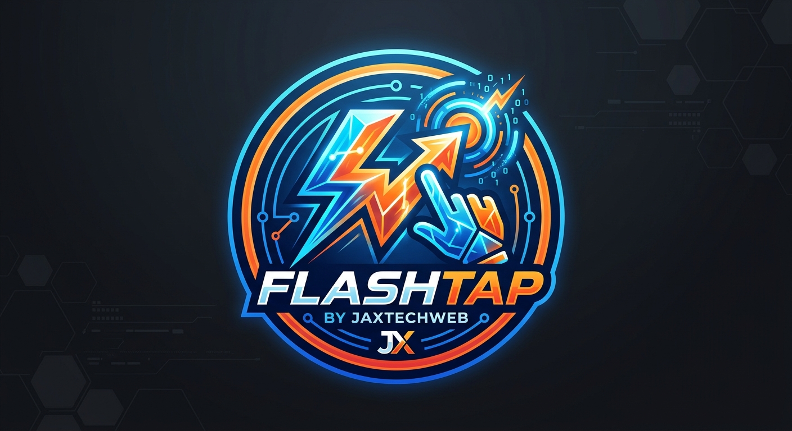

# ⚡ FlashTap



A self-hosted, local-network party quiz for **DJs and event organisers**. One
computer hosts the game and shows a big QR code on the venue's screen. Players
scan with their phones, pick a name, **vote on which question set** to play,
then tap answers as fast as they can — fastest correct finger wins the points.
While the clock runs, players spam 👍 and ❤️ and the reactions fly across the
big screen.

Built by **Jaxtech** · [nageljakes.github.io/jaxtechweb](https://nageljakes.github.io/jaxtechweb/)

---

## How a night runs

1. **Set up** — on the host screen, click the ⚡ logo: enter your DJ / company
   name, pick a venue (with venue-prefilled prizes, from the built-in venue
   list or type your own), add a scrolling ticker, and set how many questions
   per game.
2. **Join** — every phone scans the QR (or types the URL shown), types a name
   and lands in the lobby.
3. **Vote** — the host taps *Start voting*; players pick the question set they
   want (Switching your vote is allowed until everyone has voted — the set
   with the most votes is locked in and announced on the big screen).
4. **Play** — questions run from the winning set, alternating between its
   rounds so every game samples the whole set. Fastest correct answer scores
   the most (500–1000 points per question), with per-question "fastest"
   banners and a 🥇 podium + confetti finale where tonight's prizes are
   announced.
5. **Play again** — straight back to the lobby for a fresh vote.

## Quick start

```bash
npm install
npm start
```

* Players open: `http://<your-lan-ip>:3000` (a QR code is shown on the host screen and in the terminal)
* Host screen: `http://localhost:3000/host`

Flags: `--port 3001`, `--ip 192.168.x.x` (force the join address), env
`REVEAL_MS`, `LEADERBOARD_MS` to speed up a test round.

## Windows installer (for venue PCs)

`npm run build:win` builds a Windows `.exe` installer with
[electron-builder](https://www.electron.build) (NSIS target):

```bash
npm run build:win
# → dist/FlashTap Setup 1.2.0.exe
```

Everything ships inside the installer — no Node.js, no `npm install` needed on
the venue PC. Launching **FlashTap** from the desktop shortcut starts the game
server and opens the host screen in an app window (F11 for fullscreen on a TV).

During setup the wizard asks for a **license key** (`FT-XXXXX-XXXXX-XXXXX`) on
its own page and verifies it online before installing anything. Silent
installs pass it on the command line: `"...Setup 1.2.0.exe" /S /KEY=FT-...`.
At the end the installer adds a **Windows Firewall allow rule** for FlashTap
(one admin/UAC prompt — declining is fine, the app will offer the fix again on
first launch) so phones on the venue Wi-Fi can reach the server.

> **SmartScreen note:** the installer is not code-signed, so Windows may show
> "Windows protected your PC". Click **More info → Run anyway** — this is the
> standard unsigned-publisher warning, not a virus alert.

### If phones can't connect

1. The PC and phones must be on the **same Wi-Fi/LAN**, and the Windows network
   profile should be **Private** (a Public profile blocks inbound connections
   even with the allow rule on some networks).
2. Run FlashTap — if the firewall rule is missing it offers to add it
   (one admin prompt).
3. The join URL/QR on the host screen uses the PC's LAN IP — type exactly that
   into the phone (e.g. `http://192.168.1.38:3000`, not `localhost`).

### Installer troubleshooting

Setup writes two diagnostic files into `%TEMP%` that support can ask for:

* `FlashTap-Setup.log` — human-readable step log
* `ft-debug.ini` — machine markers (which steps actually ran)

A silent install without `/KEY=` fails on purpose (exit code 3).

## Licensing

FlashTap is licensed, not free-without-key. Every install must verify against
the license server (`https://tiny.tail5f36c9.ts.net` — a public URL; it works
from any normal internet connection, no VPN or Tailscale needed):

* **At install** the setup wizard asks for a license key (`FT-XXXXX-XXXXX-XXXXX`)
  and validates it with the server — an invalid or revoked key stops
  installation. Silent installs can pass `/KEY=FT-...`.
* **At runtime** the app checks in on every launch and every 30 minutes.
  A revoked key locks the app until the key is reinstated; if the machine
  is offline (venue Wi-Fi), an activated install keeps working for up to
  7 days since its last successful check.
* One key may be bound to **2 machines** (main + backup).

Administering keys happens on the license server box
(`flashtap-license new|list|revoke|reinstate|unbind` on the command line, or
the web panel on port 3212 — LAN only).

## Question sets

Sets live in `question-sets/*.json`:

```json
{
  "id": "pop-music",
  "name": "Pop Music",
  "badge": "Sing-along round",
  "description": "Chart toppers and one-hit wonders",
  "durationMs": 20000,
  "questions": [
    { "q": "Which artist released 'Thriller'?", "answers": ["Prince", "Michael Jackson", "Madonna", "Stevie Wonder"], "correct": 1, "round": "Round 1 · Pop Icons", "fact": "Still the best-selling album ever." }
  ]
}
```

* `correct` is the 0-based index into `answers`; `round` groups questions so
  one game interleaves all rounds of a set; `fact` is shown on the host
  screen during the reveal.
* Per-file extras: `durationMs`, `shuffleQuestions`, `shuffleAnswers`,
  `roundSize`.
* Ships with **11 sets / 540 questions**: a warm-up crowd-pleaser set plus the
  ten *Beerbox Pub Quiz* grand sets imported from
  [Nageljakes/quiznight](https://github.com/Nageljakes/quiznight) via
  `npm run import-quiznight -- /path/to/quizSets.json`.
* Drop your own `*.json` into `question-sets/` and restart — the voting screen
  picks them up automatically.

The venue list the setup screen offers lives in `data/venues.json`
(pubs, branches, taglines, tickers and prize ladders — seeded from the
[Nageljakes/bingo](https://github.com/Nageljakes/bingo) venue file).

## Development

```bash
npm run smoke   # end-to-end protocol test (63 assertions)
npm run demo    # drives a live game and writes screenshots/ (needs Playwright)
npm run icon    # regenerate build/icon.png + build/icon.ico (Windows shell)
npm run app     # open the Electron shell locally
```

Architecture: one Express server (`server.js`) serves the host and client
pages and speaks Socket.IO; the phone client (`public/js/client.js`) and big
screen (`public/js/host.js`) are plain JS. Timing is server-authoritative
(fastest = lowest server receipt time), answers stay hidden until the reveal,
and reactions are throttled server-side (350 ms per player).

Socket protocol: `host:register`, `host:primary`, `player:join`,
`player:vote`, `player:answer`, `player:reaction` → broadcasts
`game:phase`, `host:players`, `host:live`, `host:reaction`, `game:config`,
`player:joined`, `player:answer_ack`.

## Credits

- **Built by [Jaxtech](https://nageljakes.github.io/jaxtechweb/)** — FlashTap is
  free, open-source LAN party software; if you run a quiz night anyone ran
  with FlashTap, credit goes to the host on the mic and the players on the
  phones.
- Question sets adapted from
  [Nageljakes/quiznight](https://github.com/Nageljakes/quiznight) (10 full
  quiz nights + a warm-up set, with "did you know?" facts from the original
  notes), bundled in `question-sets/`.
- Bingo-mode setup screen (venue, branch, prizes) inspired by
  [Nageljakes/bingo](https://github.com/Nageljakes/bingo); its venue list
  ships as `data/venues.json` so first-time hosts can pick instead of type.
- ⚡ Fastest correct answer wins the points — build a set, put up a screen,
  and let the phones fly.
